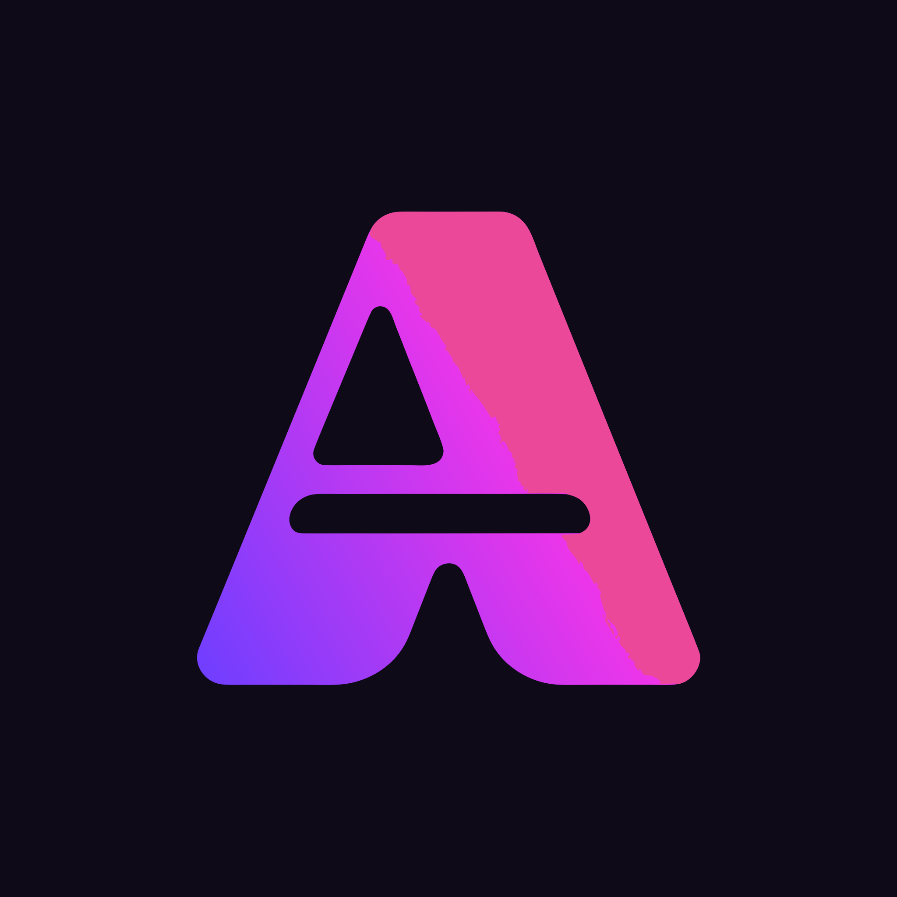

  

<h1 align="center">Angular Projects</h1>

<strong>Five production-grade full-stack Angular applications, built stage by stage, with the complete source code and a video for every stage.</strong>

  <a href="https://angularprojects.com">Website</a> ·
  <a href="https://angularprojects.com/#projects">The builds</a> ·
  <a href="https://angularprojects.com/#how-it-works">How it works</a> ·
  <a href="https://angularprojects.com/#pricing">Pricing</a> ·
  <a href="https://angularprojects.com/docs/">Docs</a> ·
  <a href="https://angularprojects.com/blog/">Blog</a>

---

Every Angular guide stops at the happy path. The auth tutorial ends at a guard hiding a link and never reaches session revocation, organisation invites, seat limits or the five refreshes an interceptor fires when a token goes stale mid-checkout. The billing tutorial ends at the first successful charge and never reaches webhook idempotency, proration or the refund that arrives after the customer has already used the feature. The deploy tutorial ends at a green build and leaves out safe database migrations, server rendering at the edge and restoring a working version when a deployment fails.

That gap is the entire curriculum. Each build is a complete, deployable product, the kind you could put a price on the week you finish it.

## The builds

| Build | In the mould of | The problems you will actually solve |
| --- | --- | --- |
| **[Shoppeya](https://angularprojects.com/#shoppeya)** Modular commerce | Medusa, rebuilt fully serverless | Holding stock under concurrent checkout, payment webhooks that survive replay, order state that stays correct when only half ships |
| **[SkillSlay](https://angularprojects.com/#skillslay)** Multi-tenant LMS | Teachable | Tenant isolation enforced in one place only, custom domains with routing per tenant, video delivered through signed links that expire, creator payouts and a revenue split |
| **[TableCraze](https://angularprojects.com/#tablecraze)** Venue reservations | OpenTable | Floor-plan constraints solved per booking, race-free slot locking, deposits and no-shows, a waitlist that promotes itself |
| **[NovaVisage](https://angularprojects.com/#novavisage)** Appointment booking | Booksy | Availability derived from staff hours on every request, never persisted; timezones that survive the daylight-saving change; holds that stay race-free when two customers want one slot |
| **[PilarTrack](https://angularprojects.com/#pilartrack)** Issue tracking | Jira, GitHub Projects | Tenant isolation you can prove row by row, a single authorisation seam, realtime presence, an audit log nothing can edit |

## What a build looks like

1. **Start with the spec:** the data model, the invariants, the ways it fails under load, and what each finished stage has to satisfy.
2. **One stage at a time:** a slice small enough to test and explicit about what done means. You write the code; nothing is generated for you and nothing is left as an exercise.
3. **Check it against the reference:** the reference implementation of that stage, tagged commit by commit, and the video where it is written, including the calls that would be made differently today, and why.
4. **Take it live:** migrations against live data, promotion between environments, observability, and a rollback you have rehearsed rather than assumed.

## The standards in every build

- Strict TypeScript, type-aware linting and validation at every system boundary.
- Unit, integration and end-to-end tests from the first stage, including failed payments, denied permissions and concurrent writes.
- Role-based permissions, session revocation and tenant isolation enforced on the server.
- Internationalisation from the start: translated routes, locale-aware dates, numbers and currencies, and explicit timezones.
- Edge delivery, server rendering and lean client bundles, with performance measured as a requirement.

## Stack

TypeScript · Angular 22 · Analog · Signals · spartan/ui · Drizzle ORM · Better Auth · Zod · Cloudflare Workers, Durable Objects, Queues, Cron Triggers and Workers AI · WebSockets · Polar · Resend · Tailwind CSS

## Status

Angular Projects is in pre-launch. [Get on the list](https://angularprojects.com/#waitlist) to get one email when a project ships. The first 100 people on the list reserve founding pricing, with no commitment to buy.

The same five builds are taught in React at [React Projects](https://github.com/reactprojectscom). [SaaSy Land](https://github.com/saasyland) gives you the foundation; these builds teach why it works and how to extend it.

Built by [Piotr Borowiecki](https://pjborowiecki.com). Questions: [support@angularprojects.com](mailto:support@angularprojects.com).
